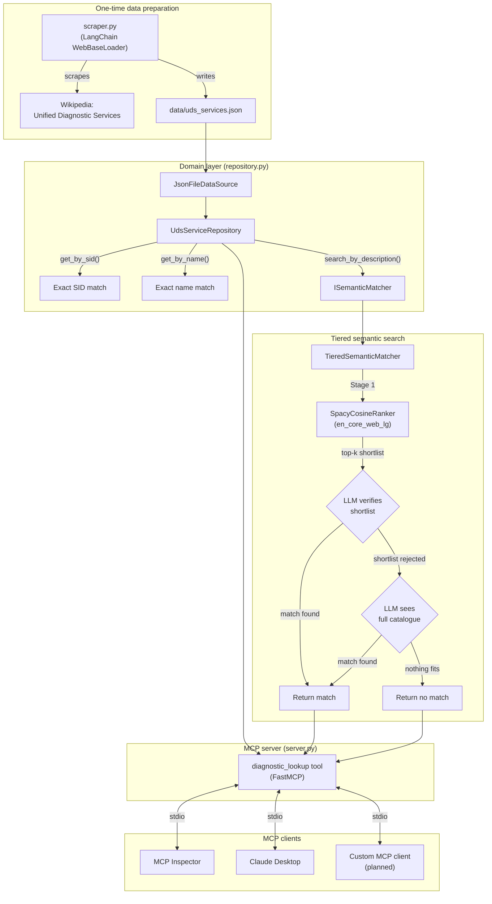

# UDS MCP Server

An MCP server that answers questions about UDS (ISO 14229) diagnostic services.
Give it a request SID, a service name, or a plain-English description, and it
returns the service name, request SID, response SID, and description — sourced
from the actual ISO 14229 services table, not from a model's general knowledge.

## Features

- **Exact SID lookup** — `0x31` → `RoutineControl`
- **Exact name lookup** — `RoutineControl` → full details
- **Natural-language search** — "how do I unlock a protected feature" → `SecurityAccess`,
  via a tiered semantic matcher (embedding similarity + LLM verification), not
  naive keyword matching
- Grounded in a locally cached copy of the Wikipedia UDS services table — no live
  scraping on every query

## Architecture



## Project layout

```
uds-mcp-server/
├── data/
│   └── uds_services.json       # Scraped source of truth
├── src/
│   ├── __init__.py
│   ├── repository.py            # Domain interfaces + UdsServiceRepository
│   ├── scraper.py                # Wikipedia scraper (LangChain WebBaseLoader)
│   ├── similarity_ranker.py      # SpacyCosineRanker (ISimilarityRanker)
│   ├── semantic_matcher.py       # TieredSemanticMatcher (ISemanticMatcher)
│   └── server.py                  # FastMCP server, diagnostic_lookup tool
├── .env                           # Local config + secrets (never committed)
├── .gitignore
├── pyproject.toml
└── README.md
```

## Setup

Requires [uv](https://docs.astral.sh/uv/) and Python 3.10+.

### 1. Install dependencies

```powershell
uv add mcp requests beautifulsoup4 langchain langchain-community langchain-openai python-dotenv spacy numpy
uv sync
```

### 2. Download the spaCy model (~560MB)

```powershell
uv run python -m spacy download en_core_web_lg
```

### 3. Configure `.env`

```
UDS_SOURCE_URL=https://en.wikipedia.org/wiki/Unified_Diagnostic_Services
UDS_OUTPUT_PATH=data/uds_services.json
UDS_USER_AGENT=uds-mcp-server/0.1 (your contact info here)
USER_AGENT=uds-mcp-server/0.1 (your contact info here)

# Optional: enables natural-language search via spaCy + Azure OpenAI.
# Without this, free-text queries return "no match" rather than guessing.
UDS_ENABLE_LLM_MATCH=true
UDS_LLM_CANDIDATE_K=5
AZURE_OPENAI_ENDPOINT=https://your-resource.openai.azure.com/
AZURE_OPENAI_API_KEY=your-key
AZURE_OPENAI_API_VERSION=2024-02-15-preview
AZURE_OPENAI_DEPLOYMENT_NAME=gpt-4
```

### 4. Build the data file

```powershell
uv run python -m src.scraper
```

## Testing

**Direct Python call** (bypasses any MCP client entirely):

```powershell
uv run python -c "from src.server import diagnostic_lookup; print(diagnostic_lookup('0x31'))"
```

**MCP Inspector** (interactive UI, no AI client needed):

```powershell
npx @modelcontextprotocol/inspector uv run python -m src.server
```

## Connect to an MCP client

The server runs over stdio:

```powershell
uv run python -m src.server
```

Point any MCP client at this command (adjust `uv`'s path and the project
directory as needed). For Claude Desktop specifically, see the config format
at `Settings → Developer → Edit Config`; note that this app's per-server logs
live under `%LOCALAPPDATA%\Claude\logs\mcp-server-<name>.log`, not
`%APPDATA%`.

## Example queries

| Query | Routed as |
|---|---|
| `0x31` | Exact SID lookup |
| `RoutineControl` | Exact name lookup |
| `how do I unlock a protected feature` | Semantic search → `SecurityAccess` |
| `what is the weather today` | Semantic search → no match (correct) |

## Known limitations

- The spaCy shortlist (Stage 1) doesn't always contain the right answer on the
  first pass — the full-catalogue LLM escalation (Stage 3) exists specifically
  to cover this, and triggers more often than not in practice.
- Free-text search requires `UDS_ENABLE_LLM_MATCH=true` and valid Azure
  credentials. Without it, `search_by_description` correctly returns no
  matches rather than falling back to weaker heuristics.
- **Tool invocation in some MCP clients is not yet confirmed.** The server
  correctly responds to `initialize`, `tools/list`, `tools/call`, etc. (verified
  via Inspector), but a specific client session showed the model answering
  from its own training knowledge rather than issuing a `tools/call` for
  UDS questions, despite the tool being registered and enabled. Root cause
  not yet isolated — pending testing with a custom MCP client for full
  visibility into the request/response flow.

## Extending

New domains (HIL/CAN signals, etc.) implement `IDataSource` and
`IServiceRepository` from `repository.py` without modifying any UDS-specific
code — same for swapping `SpacyCosineRanker` or `TieredSemanticMatcher` for a
different ranking/verification strategy later.

## Version history

- **v0.2.0** — Replaced rule-based keyword search with tiered semantic matching
  (spaCy cosine similarity + Azure OpenAI verification/escalation). Verified
  end-to-end via direct calls and MCP Inspector. Tool invocation in Claude
  Desktop not yet confirmed — flagged as a known limitation pending further
  investigation with a custom MCP client.
- **v0.1.0** — Initial scraper, repository, and MCP server with SID/name lookup
  and basic keyword search.